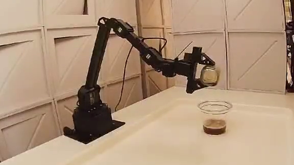
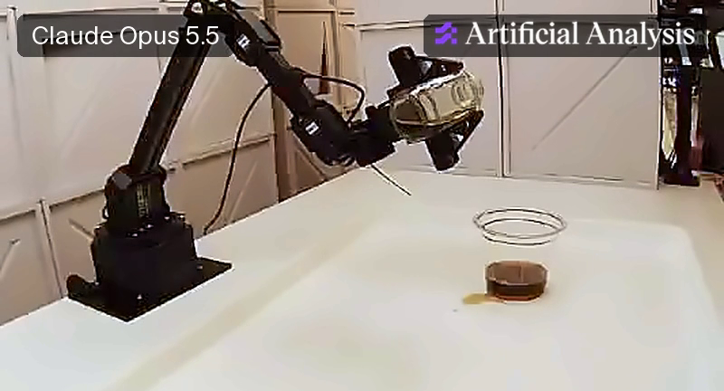
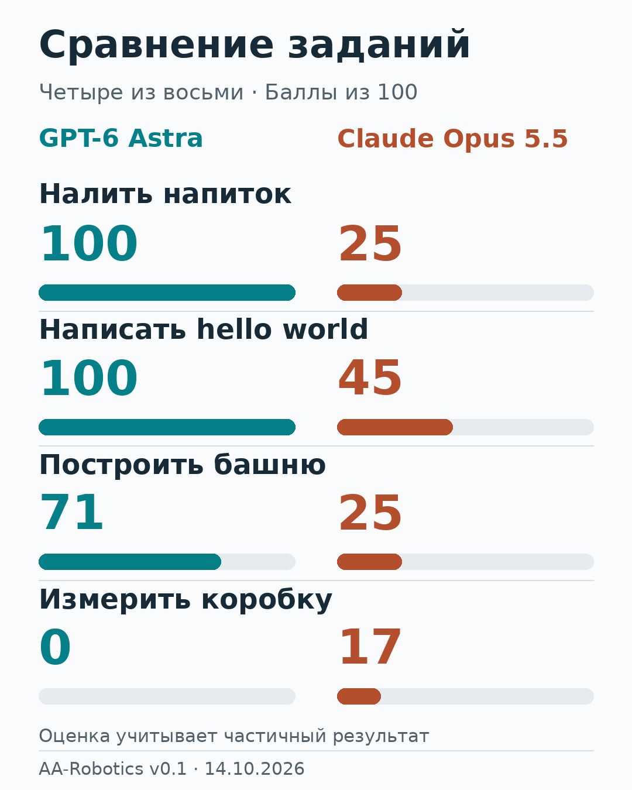
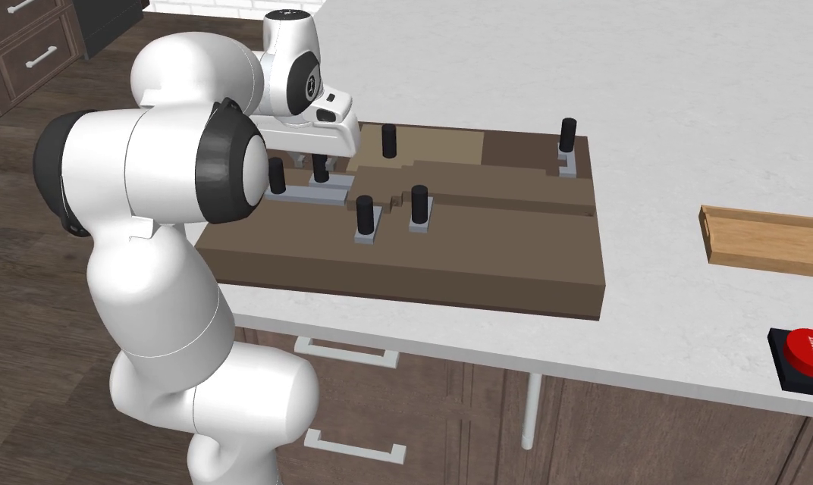
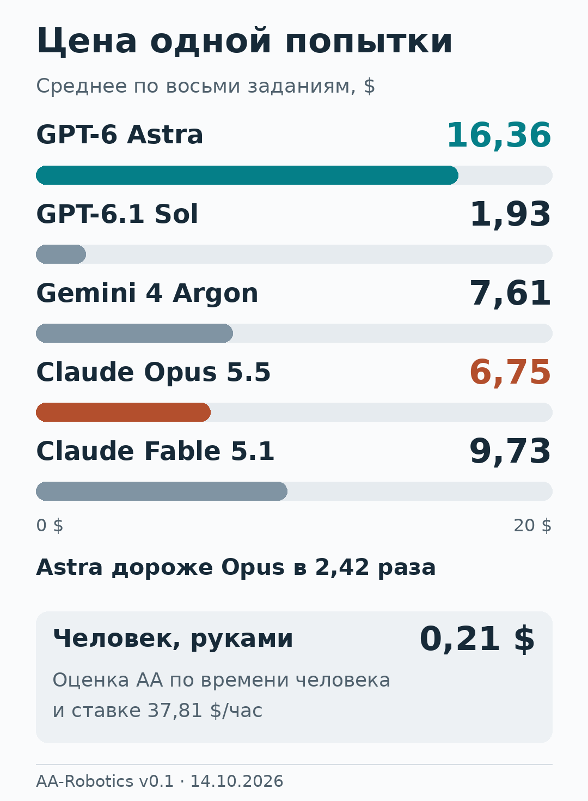

# Астра обошла Opus 5.5 в тесте с роборукой. Три задания, в которых он проиграл

Налить напиток из бутылки в стакан и ничего не пролить. В новом испытании Artificial Analysis это задание выполняет настоящая роботизированная рука под управлением языковой модели. GPT-6 Astra получает 100 баллов, Claude Opus 5.5 — 25.

После восьми заданий Астра занимает первое место по среднему баллу. Самый большой отрыв от Opus возникает в наливании, письме и строительстве башни. Эти действия интересны тем, что их результат приходится оценивать по ходу работы: струя меняется, маркер оставляет след, каждый новый блок становится частью конструкции. Ошибка следующего движения может испортить уже сделанное.

[AA-Robotics v0.1](https://artificialanalysis.ai/articles/aa-robotics), опубликованный 14 октября 2026 года, даёт возможность разобрать такое сравнение по задачам. А отдельное исследование с засовами помогает точнее поставить вопрос: что происходит, когда модель умеет выполнить движение, но должна ещё выяснить, какое движение сейчас нужно?

*Hiwonder NexArm под управлением GPT-6 Astra держит бутылку над стаканом. За это задание Астра получила 100 баллов. Кадр [записи Artificial Analysis](https://artificialanalysiscdn.com/article-assets/2026/aa-robotics/explore-v2/pour-drink-into-cup__gpt-6-astra.mp4).*

## Что модели могли делать руками

В установке AA-Robotics используется манипулятор Hiwonder NexArm. За столом наблюдают три камеры, четвёртая находится на запястье робота. Модель пишет и запускает код, передающий команды руке, а изображения позволяют увидеть последствия движения.

Для такого агента возникает непривычная по сравнению с обычным чатом последовательность. Сначала нужно соотнести предмет на картинке с положением захвата, затем выполнить движение и оценить новое состояние. Если предмет сдвинулся, следующий шаг приходится выбирать уже для изменившейся сцены.

Задач было восемь: нажать красную кнопку, поместить игрушечного крокодила внутрь прямоугольника, налить напиток, убрать четыре блока в коробку и закрыть крышку, разложить фигуры по образцу, написать маркером `hello world` внутри рамки, построить башню и измерить коробку с допуском 2 мм.

В [описании установки](https://artificialanalysis.ai/articles/aa-robotics#how-it-works) указано, что GPT работали через Codex, Claude — через Claude Code, Gemini — через Antigravity. Для моделей выбран режим усиленного рассуждения high effort. Результат относится к этим сочетаниям моделей и управляющих программ; одинаковое название режима у разных разработчиков само по себе не задаёт равный объём вычислений.

## Первое место зависит от того, что считать

Астра набрала 69,4 балла, Opus — 48,8. Разница составляет 20,6 балла. Ближайший результат к Астре — 64,6 у GPT-6.1 Sol.

Среднее складывается из полных и частичных результатов. По [таблице заданий](https://artificialanalysis.ai/articles/aa-robotics#results) у Астры четыре оценки 100 из восьми, у Opus — две, у Sol — пять. Это наш подсчёт опубликованных строк.

Sol чаще дошла до полного выполнения, а Астра заняла первое место за счёт того, как распределились баллы по всем заданиям. При выборе модели для конкретного действия поэтому полезнее сначала посмотреть его строку. Для кнопки различий между участниками вообще нет: все получили 100.

Это первые результаты версии v0.1. В публичной таблице показан один результат на каждую пару «модель — задача»; разброс оценок при повторных запусках не приведён. Заголовок про победу Астры относится к опубликованному набору испытаний.

## Три задачи, которые дали Астре отрыв

### Стакан: 100 против 25

Наливание требует учитывать движение жидкости. Даже если бутылка удерживается правильно, точка попадания струи может меняться по мере её ослабления. Удачное положение в начале действия придётся пересмотреть, если струя перестала попадать туда же.

Именно такую ошибку [описывают авторы AA-Robotics у Opus](https://artificialanalysis.ai/articles/aa-robotics#mistake-wall): ослабевшая струя стала падать ближе к бутылке, и конец порции оказался рядом со стаканом. По итоговой оценке Астра выполнила задание полностью.

*У Opus часть напитка оказалась рядом со стаканом — на столе видна лужица. Авторы связывают промах с ослаблением струи. Кадр [демонстрации Artificial Analysis](https://artificialanalysiscdn.com/article-assets/2026/aa-robotics/mistake-wall/ki-opus-pour-20m57__crop-lower.mp4).*

Этот эпизод показывает, почему в физическом действии мало однажды выбрать подходящую траекторию. Условия меняются даже тогда, когда сам захват остаётся на месте.

### Надпись: 100 против 45

У письма несколько связанных требований: маркер должен касаться бумаги, линии — складываться в читаемую фразу, сама фраза — помещаться в отведённую область. Пробное движение здесь уже оставляет след, который становится частью результата.

В авторской подборке ошибок Opus проверяет контакт маркера прямо внутри области для надписи и оставляет там отметки.

У Астры за письмо — полный балл. Эпизод Opus показывает отдельную сложность: подготовка к действию тоже меняет предмет, с которым работает робот. Место для пробы приходится выбирать с учётом конечной цели.

### Башня: 71 против 25

Башня добавляет зависимость между шагами. После каждого блока меняются высота, доступные опоры и пространство для захвата. Чтобы поставить следующий предмет, нужно учитывать уже построенную часть: движение руки проходит рядом с собственным предыдущим результатом.

Здесь обе модели получили частичные оценки: 71 у Астры и 25 у Opus. Полностью задание не выполнила ни одна из них, но по его шкале результат Астры заметно выше.

*Три крупных преимущества Астры и задача с более высоким баллом Opus. Шкала — баллы из 100 за задание; промежуточные оценки учитывают частичное выполнение. Графика Real Vibe по данным Artificial Analysis.*

Разница в этих трёх задачах — 75, 55 и 46 баллов. Всего Астра опередила Opus в четырёх заданиях, в трёх оценки совпали. В измерении коробки выше результат Opus: 17 против нуля. Четвёртая победа Астры — подбор фигур, 44 против 38.

## Захватить предмет, понять результат и вовремя остановиться

В [подборке ошибок AA](https://artificialanalysis.ai/articles/aa-robotics#mistake-wall) выделены три группы: промахи захвата и падения, неверная оценка физических последствий, ошибочное решение о завершении. Это разные затруднения. Если предмет выскользнул, потребуется новая попытка захвата; если он уже стоит как нужно, очередная поправка может сдвинуть его с удачного места.

Нажать кнопку, увидеть нажатие и остановиться — три разных решения. У более длинной задачи момент завершения может оказаться сложнее: достаточно ли высока башня, полностью ли игрушка внутри рамки, правильно ли закрылась крышка?

В [анализе поведения моделей](https://artificialanalysis.ai/articles/aa-robotics#model-behavior) исследователи приводят показательный эпизод с Sol. Примерно на 17-й минуте башня уже находилась в проходящем состоянии, но модель продолжила работу и закончила задание с провалом.

У Opus история с крокодилом растянулась ещё дольше. По аннотации AA, игрушка оказалась внутри прямоугольника на отметке 23:22. Затем агент около 22 минут продолжал поправлять её и трижды снова выталкивал за дальнюю границу. В итоге Opus получил 100 баллов; Sol справилась с этим заданием примерно за пять минут.

По конечному баллу оба результата одинаковы. Для реальной работы имеют значение ещё время и лишние действия. Каждая дополнительная поправка может изменить уже подходящее положение предмета.

Из этих эпизодов вырисовываются отдельные требования к агенту: выполнить движение, понять новое состояние и решить, стоит ли продолжать. Успешное движение само по себе решает лишь часть этой последовательности.

## Засов не сдвинулся. Что делать дальше?

Такой дополнительный ракурс даёт [RoboQuest](https://arxiv.org/html/2610.10388v1) — исследование команды DeCLaRe Lab из Наньянского технологического университета. Здесь Астра и Opus работают в симуляторе, а не с рукой на столе Artificial Analysis.

В отдельных упрощённых испытаниях известных движений результат почти одинаков: 80% у Астры и 81% у Opus. Нужные сведения уже предоставлены, робот находится перед однозначно заданной целью, а успешное завершение автоматически фиксирует тестовая среда. В этих условиях модели примерно одинаково справляются с исполнением изолированного движения.

Особенно наглядна головоломка Puzzle Box. Чтобы открыть коробку, нужно в правильном порядке сдвинуть связанные засовы. Один может удерживать другой. Если связи видны, порядок можно выяснить осмотром. Если механизм закрыт, неудачная попытка становится дополнительным сведением о его устройстве.

*Puzzle Box в симуляторе RoboQuest: на коробке видны засовы, рядом стоит поднос для извлечённого предмета. Кадр [официальной демонстрации DeCLaRe Lab](https://declare-lab.github.io/RoboQuest/assets/tasks/puzzle-box.mp4?v=699c66d626).*

В [сравнении цепочек из четырёх–пяти засовов](https://arxiv.org/html/2610.10388v1#S5.T5) авторы получили такие результаты:

| Условия головоломки | GPT-6 Astra | Claude Opus 5.5 |
|---|---:|---:|
| Связи между засовами видны | 94,4% | 94,4% |
| Связи скрыты | 96,4% | 36,8% |

*Доля успешных попыток в этих условиях Puzzle Box. Источник: RoboQuest, таблица 5; здесь используется другая метрика и другой эксперимент, чем в AA-Robotics.*

При видимых связях модели справились одинаково. После скрытия связей результат Opus резко снизился, а у Астры остался высоким.

Самая выразительная деталь находится в разборе неудач: в 12 из 26 проваленных попыток Opus не менее трёх раз тянул заблокированный засов, не меняя план.

Представим бытовую версию этой ситуации. Дверца не открывается. Можно ещё раз потянуть за ручку, а можно проверить защёлку. Вторая попытка полезна, если она проверяет новую возможность: засов всё ещё удерживается, захват промахнулся или движение выбрано в неверную сторону. Простое повторение без нового наблюдения даёт мало оснований для следующего решения.

В этих условиях результат Астры согласуется с более успешным использованием обратной связи — сведений, которые появляются после действия. Сходные оценки в упрощённых моторных пробах и расхождение на скрытом механизме делают такое объяснение предметным.

Связь с AA-Robotics здесь — наша интерпретация. Исследование RoboQuest отдельно показывает слабое место Opus в определённых задачах с неизвестными связями. Причину разрыва в наливании, письме и башне оно напрямую не проверяет: различаются среда, задачи, управляющие программы и настройки. Из опубликованных результатов также нельзя установить, какое устройство модели или какое обучение обеспечило Астре преимущество.

## Сколько стоит такой результат

У рейтинга есть ещё одна ось — стоимость. В [расчётах AA-Robotics](https://artificialanalysis.ai/articles/aa-robotics#cost-and-time) одна задача обходится Астре в среднем в 16,36 доллара, Opus — в 6,75, Sol — в 1,93. В расчёт входят и неудачные попытки.

*Стоимость обращений к моделям в долларах США за задачу, включая неудачные попытки. Человек выполнял задания руками; 0,21 доллара — оценка этого времени по ставке 37,81 доллара в час, выбранной авторами AA. Графика Real Vibe по данным Artificial Analysis.*

По нашему расчёту, Астра в среднем дороже Opus в 2,42 раза, а Sol — в 8,48 раза. При этом разница средних баллов Астры и Sol составляет 4,8. Перед нами разные сочетания качества и затрат: первое место по баллам имеет цену.

Средняя стоимость задачи также отличается от стоимости гарантированно полезного результата. Если агент потратил деньги, но не выполнил цель, следующая попытка потребует дополнительных ресурсов. В этой таблице нет цены роборуки, её обслуживания и организации рабочего места.

Человеческий ориентир стоит читать отдельно. Человек действовал собственными руками. Это сравнение с привычным способом выполнить работу; в нём не измеряется, насколько быстро человек управлял бы тем же роботом через ту же программу.

Время добавляет ещё одно различие. Большинство моделей тратили на задание около получаса, Gemini 4 Argon — около 52 минут. Работа начинается с калибровки: модель пробует команды и выясняет, как они меняют положение руки. По анализу AA, затем значительная часть времени уходит на планирование между короткими движениями.

Для будущего применения поэтому понадобятся сразу три ответа: насколько хорошо агент выполняет нужную задачу, сколько времени занимает попытка и сколько она стоит. Итоговый рейтинг отвечает только на первый вопрос — и только для выбранного набора заданий.

## Победа, которую можно разобрать по действиям

В AA-Robotics у Астры самый высокий средний балл. Основной отрыв от Opus 5.5 пришёлся на стакан, надпись и башню. В каждом случае за простой целью скрывается последовательность действий, последствия которых приходится учитывать до самого завершения.

RoboQuest добавляет к сравнению конкретную гипотезу о поведении: при неизвестных связях полезно менять следующий шаг по результату предыдущего. У Opus исследователи нашли попытки, застрявшие на повторном движении заблокированного засова; Астра в этих условиях гораздо чаще доводила головоломку до решения.

Для агента с рукой результат предыдущего движения становится частью следующего решения. Струя сместилась — нужно заново оценить положение бутылки. Засов не сдвинулся — проверить, что его удерживает. Так последовательность действий может перестраиваться прямо во время попытки, по тому, что действительно произошло с предметами.

Полные результаты, описания задач и записи запусков доступны в [интерактивном разборе AA-Robotics](https://artificialanalysis.ai/articles/aa-robotics#run-explorer). Подробный эксперимент со скрытыми связями — в [полном тексте RoboQuest](https://arxiv.org/html/2610.10388v1).
