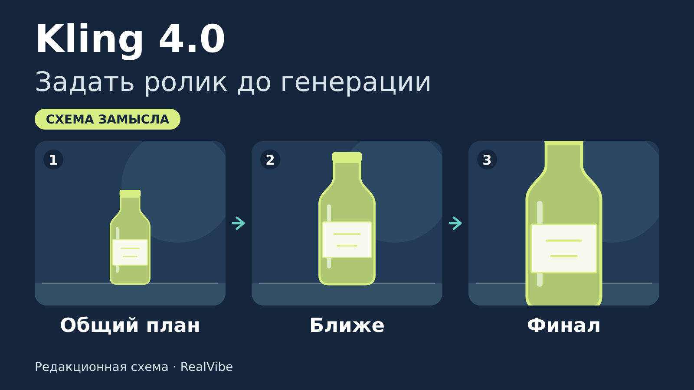
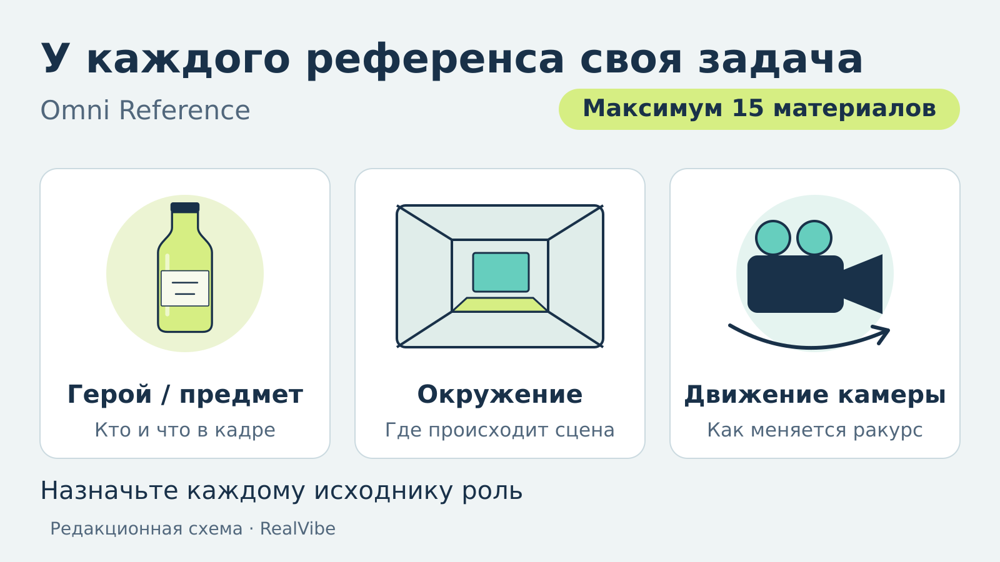
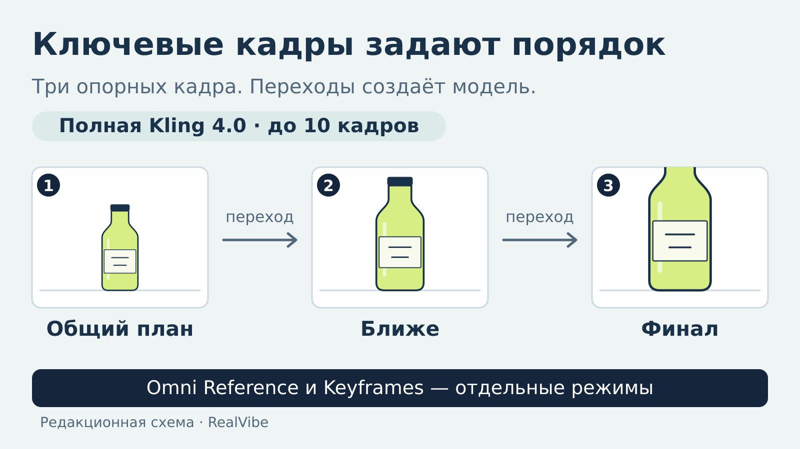
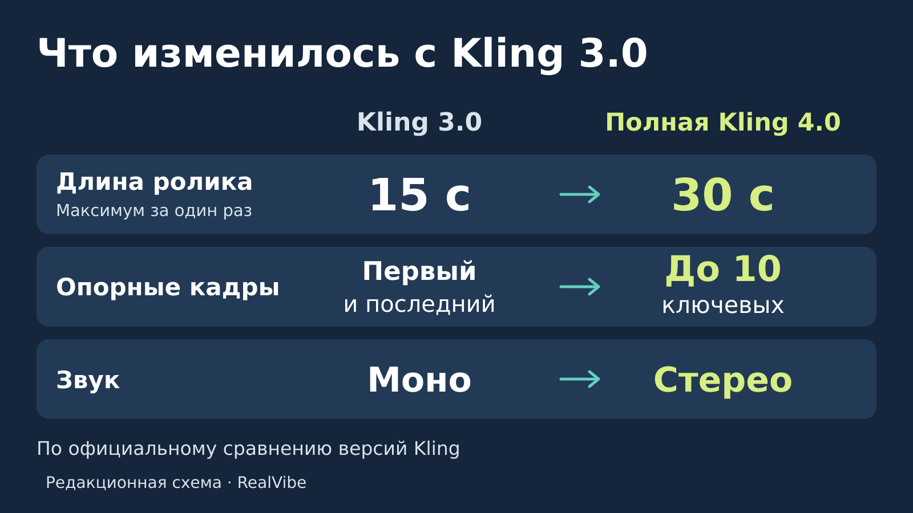
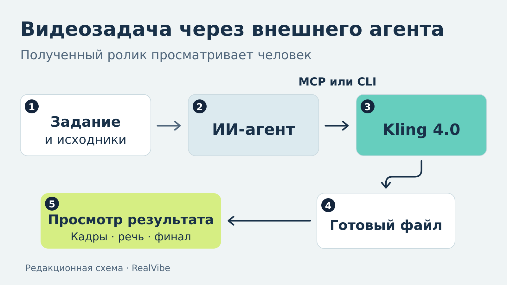

# Kling 4.0: как задать героев, движение и финал ролика ещё до генерации

Допустим, вам нужен короткий ролик с напитком: бутылка стоит на столе, камера приближается, в финале хорошо видна этикетка. Сцену легко представить. Гораздо труднее объяснить нейросети, какая именно бутылка нужна, что должно двигаться и на каком кадре остановиться.

В Kling 4.0 эту задачу можно разложить на исходные материалы и опорные изображения. Облик героя показать фотографией, движение камеры — коротким видео, последовательность событий — раскадровкой. А если уже придуманы важные моменты ролика, подготовить для них отдельные ключевые кадры.

Полная версия модели [вышла 15 октября 2026 года](https://ir.kuaishou.com/news-releases/news-release-details/kling-ai-officially-launches-next-generation-kling-40-raising). Она пригодится авторам коротких видео, дизайнерам и тем, кто делает материалы для своего проекта или бизнеса. Разберём, с чем приходить к генерации, как выбрать режим и какие этапы можно поручить ИИ-агенту. Бутылка из нашего примера — условное задание, по которому удобно объяснить подготовку ролика.

*Сначала определяем, что зритель увидит в начале и в конце. Редакционная схема: RealVibe.*

## Раскадровка: сначала рассказать историю картинками

Раскадровка — последовательность изображений с важными моментами будущего видео. Она похожа на короткий комикс: помогает объяснить, где находятся персонажи, что происходит и к чему приходит сцена.

В [официальном руководстве Kling 4.0](https://kling.ai/quickstart/kling-4-model-user-guide) есть подходящий пример: пёс-космонавт оказывается на сырной Луне. На листе восемь панелей — герой у ракеты, прыжок с вилкой, отверстие в сырной поверхности, встреча с мышью и совместная трапеза в финале. Сырная Луна заодно решает вопрос с провизией.

Такую раскадровку используют в режиме **Omni Reference** как один визуальный исходник. Лист передаёт сразу несколько решений: вид сцены, расположение героев и порядок событий. Такой способ особенно понятен, когда словами пришлось бы долго объяснять, кто откуда появился и куда направился.

Посмотреть исходник можно по [прямой ссылке на раскадровку Kling](https://static--57.klingai-cdn-aws.com/kling-blog/file_by_url/961d42867186eca64dd753536ed8a3646dc475680b377e629066fef22b5c7b94.png). Это восемь панелей одного листа-референса; отдельный режим ключевых кадров устроен иначе — до него скоро дойдём.

## Референсы: назначить каждому исходнику свою работу

Референс — образец, на который модель должна ориентироваться. В режиме **Omni Reference** можно собрать материалы разных типов и объяснить, за что отвечает каждый из них.

Для рекламы напитка это могли бы быть фотография бутылки, изображение нужного стола и короткий ролик с подходящим движением камеры. В запросе полезно прямо распределить роли: внешний вид товара взять с первого изображения, окружение — со второго, движение камеры — из видео. Так исходники получают понятное назначение.

В материалах Kling есть [лист с тремя персонажами, автомобилем, мотоциклом и съёмочным оборудованием](https://static-50.klingai-cdn-aws.com/kling-blog/file_by_url/718638a1415f12a8a259928d829f6b96678acf35f7ed493643ddd9acd835b832.png). Он показывает, насколько разнообразным может быть набор для одной сцены. А для управления камерой разработчик предлагает использовать движение из другого видео — например, перенести приём съёмки автомобиля в новое окружение.

*В одном задании образцы могут отвечать за разные стороны сцены. Их назначение нужно объяснить в запросе. Редакционная схема: RealVibe.*

По [описанию модели](https://kling.ai/blog/kling-4-ai-video-model), общий предел — **15 референсных материалов**. Внутри этой квоты допускаются до 10 изображений, до 5 видео суммарной длительностью до 30 секунд и до 7 элементов — сохранённых образцов персонажа или объекта, включая до 3 видеоэлементов. Частные максимумы не складываются в отдельный набор сверх пятнадцати.

Текстовый запрос может занимать до **8000 токенов** — небольших единиц, на которые система разбивает текст. Токен не равен слову. Для нашего примера такая длина вряд ли понадобится: достаточно назначить исходникам роли, описать действие и назвать важные детали. Пространный запрос становится полезен, когда в сцене несколько персонажей, реплик и последовательных событий.

## Ключевые кадры: зафиксировать начало, поворот и финал

Есть задачи, где важнее заранее показать конкретные состояния сцены. Например, начать с общего плана стола, приблизиться к бутылке и закончить определённой композицией с этикеткой. Для этого предназначен режим **Keyframes**, то есть ключевых кадров.

Вы загружаете опорные изображения в нужном порядке, а модель создаёт переходы между ними. Полная Kling 4.0 позволяет использовать [до десяти таких кадров](https://kling.ai/blog/kling-4-multiple-keyframes-guide). Заполнять все десять позиций необязательно. Число относится к подготовленным изображениям, а не к кадровой частоте видео.

Выбирать способ работы нужно до подготовки окончательного набора. По руководству от 14 октября, **Omni Reference и Keyframes — отдельные режимы**: в одном задании нельзя одновременно собрать пятнадцать референсов и десять ключевых кадров. В Keyframes используются изображения; образцы движения и другие референсные материалы относятся к Omni Reference.

*Автор задаёт опорные состояния, модель создаёт переходы. Редакционная схема: RealVibe.*

### Как поставить задачу с бутылкой

Подготовим три изображения одной и той же бутылки: общий план стола, более крупный план и финальную композицию с хорошо видимой этикеткой. В Keyframes соотношение сторон ролика определяется первым изображением. Для нашего примера можно сразу подготовить все три картинки в формате **16:9**. Выберем полную Kling 4.0, режим Keyframes, порядок этих изображений и длительность **10 секунд**.

Собственный пример запроса для такой задачи:

> Соедини три изображения в указанном порядке. Камера плавно приближается к бутылке. Сохрани форму бутылки и оформление этикетки. Заверши ролик композицией третьего изображения.

Входные картинки определяют важные состояния, текст объясняет движение между ними. После генерации у этого задания есть конкретные критерии просмотра: сохраняется ли форма бутылки, читается ли этикетка и заканчивается ли ролик нужной композицией.

Если пока известны только внешний вид бутылки и желаемое движение камеры, начинать удобнее с Omni Reference. Если уже готовы начало, середина и финал в картинках — с Keyframes. Это два разных набора подготовки для одной и той же рекламной идеи.

## До 30 секунд и правки готового видео

Полная модель поддерживает генерацию длительностью **от 3 до 30 секунд**. В пределах одного задания можно запланировать несколько связанных действий: появление предмета, приближение камеры, финальный акцент. Длительность выбирается под эту последовательность.

В 4.0 есть и задачи по изменению готового видео: добавить или заменить объект, изменить окружение, стиль, действие либо работу камеры. В официальных примерах встречаются сцена с ящиком, куда добавляют персонажа, и корги, которому меняют стиль изображения. Это полезный сценарий, когда уже есть исходный ролик и понятно, какой его участок нужно переработать. [Описание видеоредактирования](https://kling.ai/blog/kling-4-ai-video-model) допускает до пяти входных видео, включая основное, при общей длительности до 30 секунд.

В [официальном сравнении с серией 3.0](https://kling.ai/blog/kling-4-vs-3) максимальная длительность выросла с 15 до 30 секунд, число опорных изображений — от первого и последнего кадра до десяти ключевых. Звук стал двухканальным: 4.0 заявлена со стерео.

*Три изменения по официальному сравнению Kling: предел длительности, число опорных изображений и звуковые каналы. Редакционная схема: RealVibe.*

У серии 3.0 уже были генерация со звуком и видеоредактирование; поддержка [нативного 4K появилась в ней ещё до выхода 4.0](https://kling.ai/blog/kling-ai-introduces-native-4k-video-model). Новизна нынешней версии заметна в том, сколько решений можно задать внутри одной задачи, и в расширении этих возможностей.

## Canvas и ИИ-агент: как организовать работу

Вместе с моделью Kling показывает [обновлённое рабочее пространство](https://kling.ai/blog/kling40-kling-visual-realism-creative-control-introducing-storytelling). Материалы можно просматривать списком или сеткой. Timeline помогает работать с последовательностью, а Canvas — собирать исходники и связанные результаты на одном поле. В примере Canvas справа также открыт встроенный помощник Agent.

Для серии роликов важен ещё один способ работы: обращаться к Kling из внешнего ИИ-агента. **MCP** подключает инструменты сервиса к такому агенту; **CLI** позволяет обращаться к сервису командами. В релизе 4.0 оба способа заявлены доступными, в том числе для Omni Reference и генерации с ключевыми кадрами.

Производитель связывает этот доступ с выпуском маркетинговых материалов, коротких видео, предварительной визуализацией раскадровок и работой с повторяющимися персонажами. Практический смысл — передать агенту последовательность операций: подготовить задание из брифа и исходников, отправить его, дождаться выполнения и сохранить результат.

*Пример организации процесса: агент отправляет задание, получает ссылку и сохраняет файл, затем готовое видео просматривают. Редакционная схема: RealVibe.*

У такого процесса есть вполне прикладные условия. В [руководстве MCP/CLI](https://kling.ai/app/mcp/guide) указаны оплаченные кредиты личного аккаунта; бонусные кредиты и баланс Team для этого маршрута не подходят. Ссылки на результаты действуют **24 часа**, поэтому сохранение файла стоит включить в сам процесс. Задание после отправки нельзя отменить — число вариантов и бюджет лучше задать до запуска серии.

Для знакомства с подключением есть [официальный репозиторий инструментов Kling](https://github.com/klingai-tech/skills). Анонсированный API именно для модели 4.0 на момент запуска оставался будущей возможностью. Формулировка «MCP раньше API» описывает порядок доступа к этой версии.

## «Клюёт сегодня только у нейросетей»: русская речь и цена попытки

На одном из скриншотов, предоставленных для этого разбора, показан рыбак в жёлтом дождевике на туманном причале. Ему приписана реплика: **«Клюёт сегодня только у нейросетей»**. Рядом отмечены режим «текст в видео», русская речь, синхронизация губ и параметры **10 секунд · 1080p · 150 кредитов**. Русскую речь и совпадение губ заявляет подпись на слайде; без исходного видео со звуком оценить их качество мы не можем.

С ценой граница конкретнее. **150 кредитов — указанная стоимость этого примера**, а не универсальная цена любого десятисекундного ролика в Kling 4.0. Если при тех же условиях делать три попытки, получится 450 кредитов; пять — 750. Это расчёт для планирования, а не сведения о том, сколько попыток сделал автор.

Для своей задачи полезно считать расходы на получение нужного варианта: выбрать модель и режим, посмотреть стоимость перед запуском, затем определить допустимое число повторов. При работе через агента этот предел особенно удобно оговорить вместе с заданием.

## Полная версия, Flash и обещанные возможности

Перед первым запуском стоит проверить название выбранной модели. По руководству, **Kling 4.0 Flash ограничена 20 секундами и 720p** и не поддерживает несколько ключевых кадров. Для примера с тремя опорными изображениями нужна полная 4.0.

На материалах запуска встречаются и другие крупные числа. Здесь у каждого свой статус:

| Возможность | Что известно по материалам запуска |
| --- | --- |
| Вывод вплоть до 4K | Заявлен для полной модели. Официальные страницы расходятся в формулировках доступности; наличие нужного режима в конкретном аккаунте этим обзором не установлено. |
| 10-битный HDR при 1080p и 4K | Обозначен как будущая возможность. HDR относится к расширенному диапазону яркости и передаче изображения; это отдельный параметр от разрешения. |
| Продление до двух минут | Помечено как будущая функция: видео предполагается многократно продлевать до двух минут. Максимум одной обычной генерации полной 4.0 — 30 секунд. |
| API для Kling 4.0 | При запуске анонсирован. MCP и CLI уже указаны как доступные способы подключения. |

Статусы сверены с [корпоративным релизом](https://ir.kuaishou.com/news-releases/news-release-details/kling-ai-officially-launches-next-generation-kling-40-raising), [анонсом рабочего пространства](https://kling.ai/blog/kling40-kling-visual-realism-creative-control-introducing-storytelling) и [руководством модели](https://kling.ai/quickstart/kling-4-model-user-guide). Плашка «Цены: ?» на слайде про доступ относится к API; распространять её на все режимы сервиса оснований нет.

Для ролика с напитком первый шаг теперь вполне предметный. Можно собрать фотографию товара, нужное окружение и образец движения для Omni Reference. Или подготовить три последовательных изображения для Keyframes и описать переходы между ними. В обоих случаях до нажатия кнопки уже определены сцена, действие, финальная композиция и бюджет попыток — именно с этим набором решений и начинается работа над конкретным видео.

*Материал подготовлен по документации и материалам запуска, проверенным 19 октября 2026 года. Иллюстрации RealVibe — редакционные схемы; собственный тест качества генерации не проводился.*
