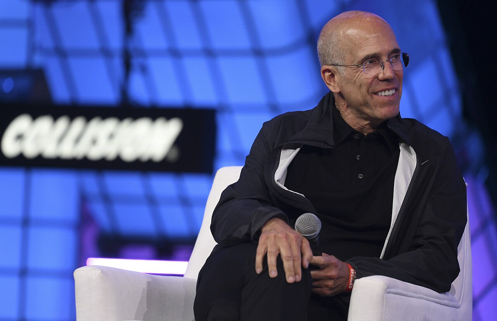
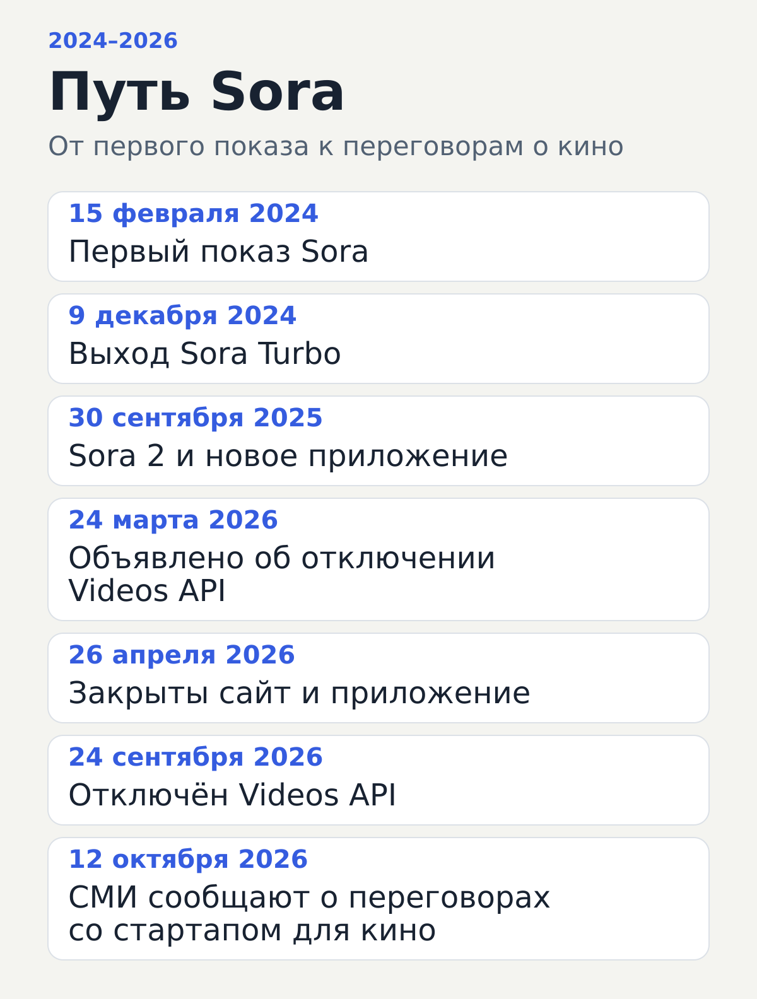
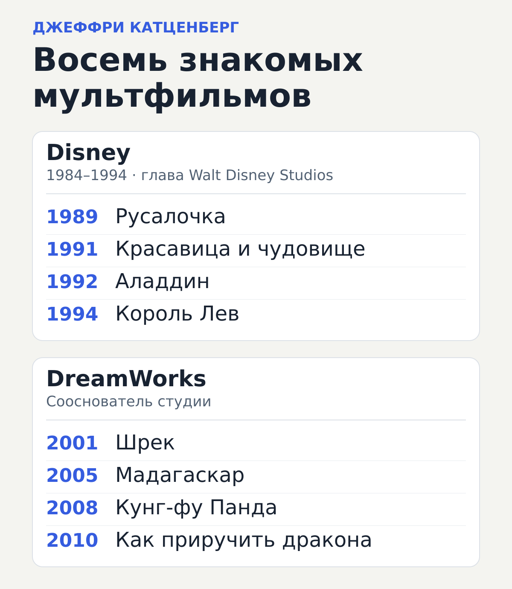

# Sora может получить вторую жизнь у сооснователя DreamWorks

У Sora появился возможный путь в кино. По сообщениям СМИ, OpenAI обсуждает доступ к своей видеомодели со стартапом, среди основателей которого — Джеффри Катценберг, бывший руководитель исследований Sora Билл Пиблз и бывший финансовый директор Dropbox Суджай Джасва. Команда хочет адаптировать технологию для кинематографистов и продавать программное обеспечение и услуги на её основе.

Об этом 12 октября 2026 года [сообщило PYMNTS](https://www.pymnts.com/news/artificial-intelligence/2026/openais-video-model-sora-could-get-a-second-act/) со ссылкой на The Information и его осведомлённого собеседника. Публичные сервисы Sora к этому времени уже закрылись. Теперь обсуждается возможность применить ту же технологическую основу в профессиональном производстве.

Фамилия Катценберга придаёт этой истории особый интерес. Его карьера связана с «Русалочкой», «Королём Львом», «Шреком» и «Как приручить дракона». Он знает, как устроена большая анимационная студия: от выбора истории и работы с авторами до производства и выпуска фильма. А рядом с ним — человек, который знает Sora изнутри.

<!-- media: cover -->

*Джеффри Катценберг на конференции Collision в Торонто, 2022 год. Фото: Stephen McCarthy / Collision via Sportsfile, Collision Conf; [CC BY 2.0](https://creativecommons.org/licenses/by/2.0/). Уменьшенная версия [Wikimedia Commons](https://commons.wikimedia.org/wiki/File:Jeffrey_Katzenberg_(52166167548).jpg).*

## Что осталось после закрытия Sora

Чтобы понять предмет переговоров, полезно разделить модель и способы доступа к ней. Модель создаёт видео по запросу. Сайт и приложение дают человеку интерфейс для работы с ней. API позволяет обращаться к модели из другой программы — например, встроить генерацию в собственный инструмент.

У этих частей разная судьба. Можно перестать поддерживать приложение, сохранив разработанную технологию и возможность договариваться о её дальнейшем использовании. Именно такой сценарий описывают сообщения о команде Катценберга.

История Sora началась **15 февраля 2024 года**: тогда OpenAI [показала первую модель и исследование](https://openai.com/index/video-generation-models-as-world-simulators/). В демонстрациях по текстовому описанию появлялись движущиеся сцены с людьми, животными, городами и предметами. 9 декабря того же года [вышла Sora Turbo](https://openai.com/index/sora-is-here/) — версия, доступная пользователям через отдельный продукт.

**30 сентября 2025 года** OpenAI [представила Sora 2 и новое приложение Sora](https://openai.com/index/sora-2/).

Сворачивание тоже шло поэтапно. 24 марта 2026 года OpenAI уведомила разработчиков о будущем отключении Videos API и доступных через него моделей Sora 2. **26 апреля закрылись сайт и приложение. 24 сентября — Videos API.** Эти даты указаны в [справке OpenAI](https://help.openai.com/en/articles/20001152-what-to-know-about-the-sora-discontinuation) и [документации для разработчиков](https://developers.openai.com/api/docs/deprecations).

PYMNTS связывает закрытие Sora с сокращением побочных проектов, концентрацией на основном бизнесе и подготовкой OpenAI к IPO — первичному размещению акций. У возможного партнёрства появляется понятная отправная точка: в Sora уже вложены исследования и инженерная работа, а её публичные сервисы к октябрю были отключены.

<!-- media: sora-timeline -->

*Хронология Sora по релизам и документации OpenAI; сведения о переговорах — по [сообщению PYMNTS от 12 октября 2026 года](https://www.pymnts.com/news/artificial-intelligence/2026/openais-video-model-sora-could-get-a-second-act/). Инфографика: Реальный Vайб.*

## От «Русалочки» к «Шреку»

С **1984 по 1994 год** Катценберг возглавлял Walt Disney Studios. [Официальная энциклопедия Disney](https://d23.com/a-to-z/katzenberg-jeffrey/) отмечает его тесную работу с анимационным направлением и участие в развитии фильмов этого периода.

Это **[«Русалочка» (1989)](https://d23.com/a-to-z/little-mermaid-the-film/), [«Красавица и чудовище» (1991)](https://d23.com/a-to-z/beauty-and-the-beast-film/), [«Аладдин» (1992)](https://d23.com/a-to-z/aladdin-film/) и [«Король Лев» (1994)](https://d23.com/a-to-z/lion-king-the-film/)**. Четыре названия, по которым легко представить масштаб его работы в Disney. Катценберг участвовал в этих проектах как руководитель студии.

Следующий этап — DreamWorks, которую он основал вместе со Стивеном Спилбергом и Дэвидом Геффеном. С работой Катценберга в DreamWorks связаны **[«Шрек» (2001)](https://www.dreamworks.com/movies/shrek), [«Мадагаскар» (2005)](https://www.dreamworks.com/movies/madagascar), [«Кунг-фу Панда» (2008)](https://www.dreamworks.com/movies/kung-fu-panda) и [«Как приручить дракона» (2010)](https://www.universalpicturesathome.com/movies/how-to-train-your-dragon-2010)**. В 2004–2016 годах Катценберг занимал должность генерального директора DreamWorks Animation; этот период указан в его [официальной биографии](https://www.aura.com/leadership).

<!-- media: filmography -->

*Восемь фильмов из разных этапов карьеры Катценберга: руководства Walt Disney Studios и работы в DreamWorks. Инфографика: Реальный Vайб.*

Катценберг уже говорил о собственных планах. В [интервью TheWrap от 25 сентября](https://www.thewrap.com/industry-news/business/jeffrey-katzenberg-ai-animation-studio/) он рассказал, что хочет создать цифровую платформу либо студию для анимационных фильмов и телевидения с использованием ИИ. Его замысел — соединить новые инструменты с сильными кинематографистами.

В том же разговоре он объяснял свой интерес снижением барьеров: если производство станет доступнее, появится возможность делать больше фильмов и пробовать новые формы повествования. Это его взгляд на будущее анимации. Октябрьская новость о переговорах вокруг Sora показывает один из возможных технологических путей для такой работы.

## Кто собирается работать с Катценбергом

Билл Пиблз руководил исследованиями Sora. OpenAI указывает его среди руководителей разработки [Sora 2](https://openai.com/index/sora-2/). Для потенциального проекта это опыт человека, который участвовал в создании самой технологии.

Суджай Джасва добавляет другой опыт. В **2010–2015 годах** он работал в Dropbox, где занимал должности финансового директора и руководителя бизнес-направления. В [официальной биографии](https://www.aura.com/leadership) описана его работа над коммерческой и финансовой организацией компании в период её роста.

Катценберг и Джасва также являются сооснователями технологической инвестиционной компании **[WndrCo](https://www.wndr.vc/team/sujay-jaswa)**. Это их уже существующая деловая связь. Название нового стартапа в сообщении о Sora не раскрыто.

## Что хотят получить от OpenAI

Ключевое слово в сообщении о переговорах — **адаптация**. По словам собеседника издания, в случае сделки стартап получил бы достаточно глубокий доступ, чтобы существенно приспособить Sora под свои задачи. На этой основе он планирует продавать программное обеспечение и другие услуги.

Публично не раскрыто, какой именно доступ получит стартап и будут ли в него входить **веса модели** — параметры, приобретённые во время обучения. Они определяют, как модель обрабатывает данные и формирует результат. Получать готовое видео через внешний сервис и иметь возможность глубоко изменять работу модели — разные технические возможности.

Авторы сообщения обращают внимание, что разработчики обычно тщательно контролируют доступ к весам. Они допускают более тесное сотрудничество с Пиблзом, поскольку он знает Sora изнутри.

По данным [The Information](https://www.theinformation.com/newsletters/ai-agenda/openais-plan-revive-sora), при сделке OpenAI получила бы долю в стартапе; её размер неизвестен.

На дату подготовки статьи, **19 октября 2026 года**, в изученных публикациях нет официального подтверждения завершённой сделки, показанного продукта или даты его выхода.

## Зачем видеомодель может понадобиться режиссёру

Представим обычную творческую задачу. В будущем анимационном фильме герой выходит из дома, замечает что-то за пределами кадра, и камера постепенно показывает зрителю большое пространство. События в сценарии уже описаны, а визуальное решение ещё ищут.

Сцена может начинаться с крупного плана лица или с маленькой фигуры на фоне дома. Камера может двигаться вместе с героем или открывать пространство издалека. Свет, темп движения и момент, когда зритель замечает нужную деталь, меняют настроение эпизода.

Здесь понятен один из возможных сценариев работы с видеогенерацией: пробовать короткие движущиеся наброски сцены и обсуждать варианты с командой. Такой предварительный поиск часто называют **превизуализацией**, или коротко превизом: будущую сцену показывают в черновом виде до её окончательного производства.

Это условный пример, который помогает объяснить интерес кинематографистов к технологии. Набор функций стартапа Катценберга ещё не представлен.

Допустим, режиссёру понравились движение камеры и настроение наброска. Следующая просьба уже гораздо конкретнее: сохранить эту композицию, дать герою задержаться у двери и изменить момент появления важного объекта. Для подобной работы ценность инструмента определяется тем, насколько точно он принимает правки.

В соседнем кадре должен остаться тот же герой. Комната должна выглядеть знакомо с другого ракурса. Выбранный предмет должен оказаться там, где его оставили. Такие связи помогают зрителю верить происходящему, а команде — собирать отдельные сцены в фильм.

OpenAI сама описывала в материалах ранней Sora ошибки физики, изменения состояния предметов и несогласованности в длинных сценах. В [исследовании 2024 года](https://openai.com/index/video-generation-models-as-world-simulators/) приводились примеры проблем с разбивающимся стеклом и взаимодействием с едой. Для производства это конкретные задачи, над которыми приходится работать: движение, постоянство деталей и связь между действиями.

Из этого становится понятнее, зачем стартапу может понадобиться глубокая адаптация. Кинематографистам полезна возможность управлять процессом: уточнять сцену, сохранять удачные решения, возвращаться к предыдущему варианту, согласовывать результат с остальным фильмом. Какие из этих задач выберет команда, станет видно по её продукту.

## В чём может состоять новая жизнь Sora

Для студии считать придётся всю работу над пригодной сценой: генерации, отбор вариантов, исправления и время специалистов. Пользу инструмента покажет возможность вернуться к удачному варианту, внести нужные изменения и сохранить уже принятые решения.

В нашем условном эпизоде задача выглядит так: герой задерживается у двери, камера сохраняет выбранное движение, важный предмет появляется в нужный момент. Если будущий продукт даст такой контроль, режиссёр получит правку, с которой команда сможет продолжить работу над фильмом. Именно в этой работе и может начаться новая жизнь Sora.
